# Four query engines, four billion weather rows, one laptop

*What I learned racing Trino, Spark, StarRocks and DuckDB on the same Iceberg lakehouse, and everything that broke along the way.*

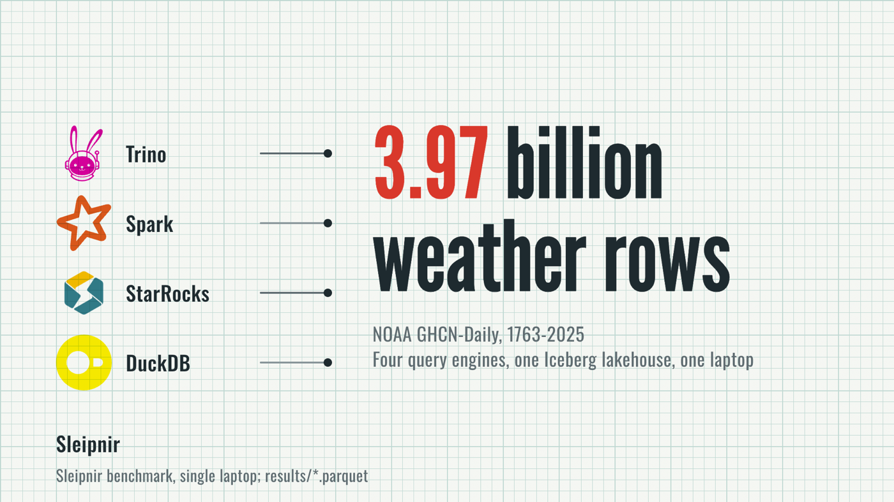

**TL;DR** The engine that surprised me most was **DuckDB**. Running inside a single process, with no server at all, it loaded 742 M rows in 146 s, had the best TPC-H time, won three of the five filtered questions, and nearly halved its whole-table scan when I doubled the CPU. But the more interesting stuff is in the rest of the post: doubling the CPU made one Trino query **2× slower** (the bottleneck was the object store), a Spark session leak held **4.4 million** Iceberg snapshot objects in memory, pre-aggregations answered in **16–34 ms** at any scale, and Postgres needed **35×** the disk of Parquet. All of this on one laptop, so read it as "this setup", not as a ranking :)

## How it started

A few weeks ago I just wanted a public dataset big enough to push Cube.dev's pre-aggregations to their limit.

I found one: over 260 years of daily weather records from stations all over the world, published by the US weather and climate agency (NOAA). From 1763 to 2025, that's 3.97 billion rows.

Then I thought... why stop at Cube when I had Claude to help me test more tools?! I've worked with Trino, Spark and dbt for years, with partitioning, cluster by, incremental models, delete+insert and table maintenance. I know how they behave in the projects I've worked on. This was a chance to look at all of it from another angle, with a public dataset, every engine on exactly the same limits, and a bigger pile of data than I'd usually throw at DuckDB.

My bet going in: **DuckDB would win almost everything.** (Spoiler: it didn't, and that's where it got interesting.)

The benchmarks I could find that tested things this way were on older engine versions and different data volumes. Spark 4 was out, Trino and StarRocks had moved a lot, and I had three questions I couldn't answer from what was already published:

- **How far does Postgres go** before you actually need a lakehouse stack?
- **Do the new versions of Spark and Trino** change the picture?
- **Is DuckDB a good option for ingestion and compression** at billions of rows?

So I built a small lakehouse on my laptop and called it **Sleipnir**.

Why the name? In Norse mythology, Sleipnir is Odin's horse: eight legs, the fastest of all horses. That felt right for a benchmark that is, in the end, a race. And it fits the shape of the project: many legs (Trino, Spark, StarRocks, DuckDB, Postgres) carrying one body, the same lakehouse, where every engine reads and writes the same tables. A horse with eight legs only runs if they move together, and that was the whole point: same data, same limits, same questions for every engine.

## What I wanted to find out

Put simply: if every engine gets the same machine, the same tables and the same semantic layer, how fast does each one load, transform and serve the data? And what do the usual acceleration tricks (materialized views, pre-aggregations, compaction) actually buy you?

I wanted the boring version: the same files, the same limits, the same questions, and every answer checked before its time counts. And I wanted it on a **single worker** first, on purpose: a baseline of what one node can do, so that the multi-worker version in the cloud (with network and throughput in the picture) has something to be measured against.

## The data

Everything runs on **NOAA GHCN-Daily**, the Global Historical Climatology Network: daily weather observations from stations all over the world, published by NOAA's National Centers for Environmental Information as one CSV per year ([ncei.noaa.gov/pub/data/ghcn/daily](https://www.ncei.noaa.gov/pub/data/ghcn/daily/)).

A few things I didn't know before starting:

- The history starts in **1763**. There are no yearly files for 1750–1762 on the server.
- The early centuries are tiny compared with recent years, which reach ~28 M rows each. That difference ends up mattering (more on that later).
- In 1797 so few stations reported that an *approximate* median came out 12% off the exact one. Fine for a dashboard, but it fails a correctness check.

I loaded it at four scales. The names are a bit cryptic, so here's what they mean (and yes, `r2` *is* about Cloudflare R2):

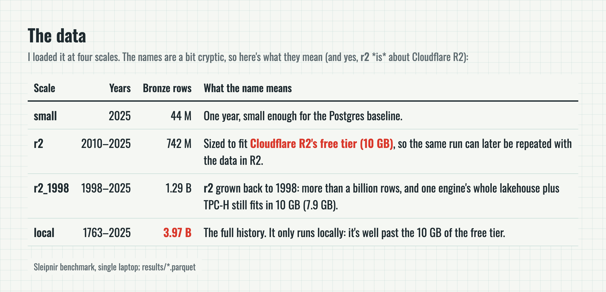

*The four data scales: years covered, bronze rows and what each name means.*

| Scale | Years | Bronze rows | What the name means |
|---|---|---|---|
| `small` | 2025 | 44 M | One year, small enough for the Postgres baseline. |
| `r2` | 2010–2025 | 742 M | Sized to fit **Cloudflare R2's free tier (10 GB)**, so the same run can later be repeated with the data in R2. |
| `r2_1998` | 1998–2025 | 1.29 B | `r2` grown back to 1998: more than a billion rows, and one engine's whole lakehouse plus TPC-H still fits in 10 GB (7.9 GB). |
| `local` | 1763–2025 | **3.97 B** | The full history. It only runs locally: it's well past the 10 GB of the free tier. |

To give the incremental strategies real work, the ingestion creates duplicates on purpose: each batch repeats the last 7 days of the previous one, and ~1% of the rows come back with a revised value.

For a second, more standard workload I also generated **TPC-H** at SF8 with DuckDB. Those results are derived from TPC-H and are not comparable to published TPC-H results.

## The stack

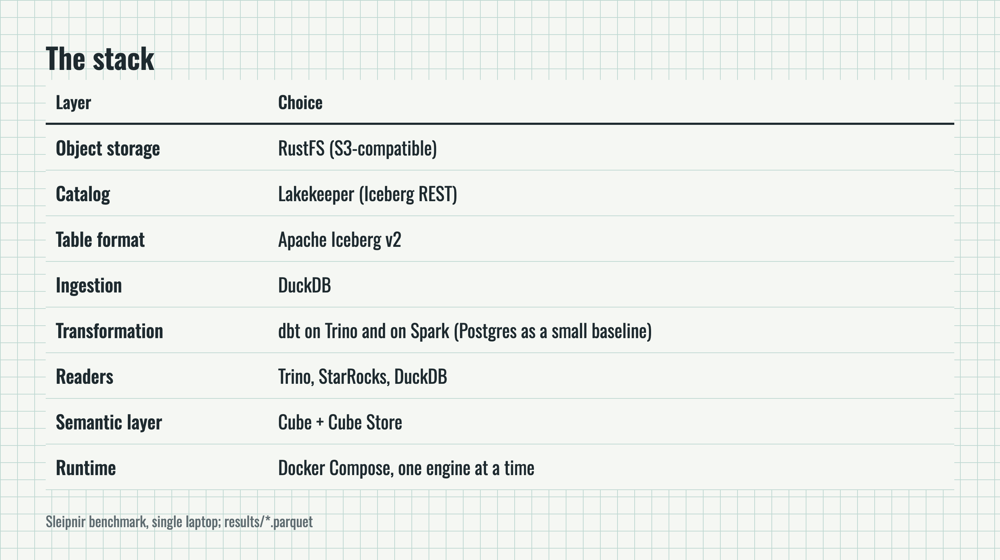

*The stack, layer by layer.*

| Layer | Choice |
|---|---|
| Object storage | RustFS (S3-compatible) |
| Catalog | Lakekeeper (Iceberg REST) |
| Table format | Apache Iceberg v2 |
| Ingestion | DuckDB |
| Transformation | dbt on Trino and on Spark (Postgres as a small baseline) |
| Readers | Trino, StarRocks, DuckDB |
| Semantic layer | Cube + Cube Store |
| Runtime | Docker Compose, one engine at a time |

One writer, many readers on the same files. Every engine reads the same Iceberg tables through the same catalog.

A note on how this got built: most of the stack was written with Claude, as an AI coding assistant. I wrote a spec first (architecture, suites, rules, open questions), then worked through it with Claude, with small agents doing scoped tasks and spikes in parallel. That made it possible to stand up a stack with seven moving parts in days instead of weeks. It did **not** make it right by default: a good part of this post is about bugs that only showed up when the numbers looked weird. AI makes building fast; checking is still on you :)

## The machine

Everything ran on one laptop:

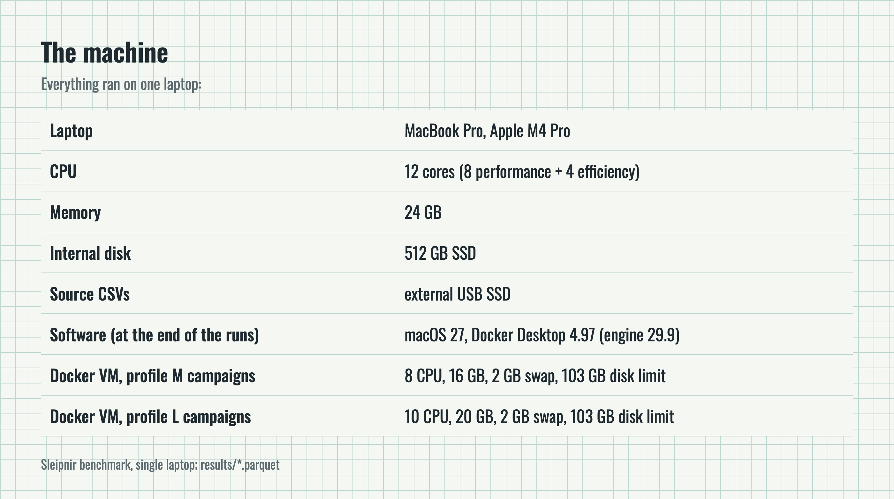

*The machine and Docker VM settings used for the runs.*

| | |
|---|---|
| Laptop | MacBook Pro, Apple M4 Pro |
| CPU | 12 cores (8 performance + 4 efficiency) |
| Memory | 24 GB |
| Internal disk | 512 GB SSD |
| Source CSVs | external USB SSD |
| Software (at the end of the runs) | macOS 27, Docker Desktop 4.97 (engine 29.9) |
| Docker VM, profile M campaigns | 8 CPU, 16 GB, 2 GB swap, 103 GB disk limit |
| Docker VM, profile L campaigns | 10 CPU, 20 GB, 2 GB swap, 103 GB disk limit |

Two things worth knowing before reading the numbers. The engines run inside a Linux VM, not on macOS directly, and the VM's CPUs are scheduled by macOS on whatever core is free: there's no way to pin them to the performance cores, so a run can land partly on the slower ones. And the VM size itself moves the numbers a little: going from 16 to 20 GB made the same queries 2–13% faster with the same engine limits, so every result records the VM size next to it.

## Keeping it fair

These rules made the numbers worth publishing, and they also caused most of the extra work:

- **One engine under test at a time.** Never two transformations in parallel.
- **Same CPU and memory for every engine.** Profile **M** = 4 CPU / 8 GB, profile **L** = 8 CPU / 12 GB, as container limits.
- **Correctness before speed.** Every query result is compared (row count + checksum) with a DuckDB reference. A fast wrong answer is recorded as invalid.
- **Results are produced, never edited.** A bad run is re-run or listed as invalidated, with the reason. The original rows stay.
- **Every engine-specific setting is recorded** next to the numbers.

## Results

> All of this is **for this setup**: one node inside a Docker VM on a Mac, this dataset (append-heavy time series), these queries. If your workload is different, test it. The point of the repo is that you can.

> And to be upfront: **this was not a perfectly fair test, and I know it.** A laptop is not a lab. macOS swapped during some runs, and the system can start a background process (indexing, a backup, an update) in the middle of a measurement without leaving a trace. I logged free memory and swap around every measured step and invalidated every run I could catch, but not everything leaves a trace. That's the main reason for the next round in the cloud: a dedicated machine with nothing else running on it.

Unless a table says otherwise, times are the median of 5 warm runs, and profile M is 4 CPU / 8 GB per engine.

### Loading (DuckDB)

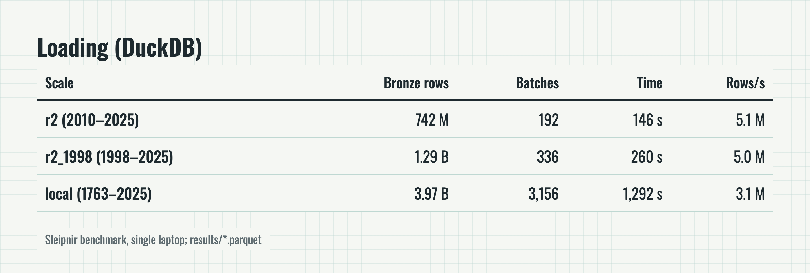

*Loading with DuckDB: batches, time and rows per second for each scale.*

| Scale | Bronze rows | Batches | Time | Rows/s |
|---|---|---|---|---|
| `r2` (2010–2025) | 742 M | 192 | 146 s | 5.1 M |
| `r2_1998` (1998–2025) | 1.29 B | 336 | 260 s | 5.0 M |
| `local` (1763–2025) | 3.97 B | 3,156 | 1,292 s | 3.1 M |

The full history is slower per row: the early centuries are thousands of tiny batches that each pay a fixed cost, and the CSVs came from a USB SSD.

### Transforming: build from scratch (dbt)

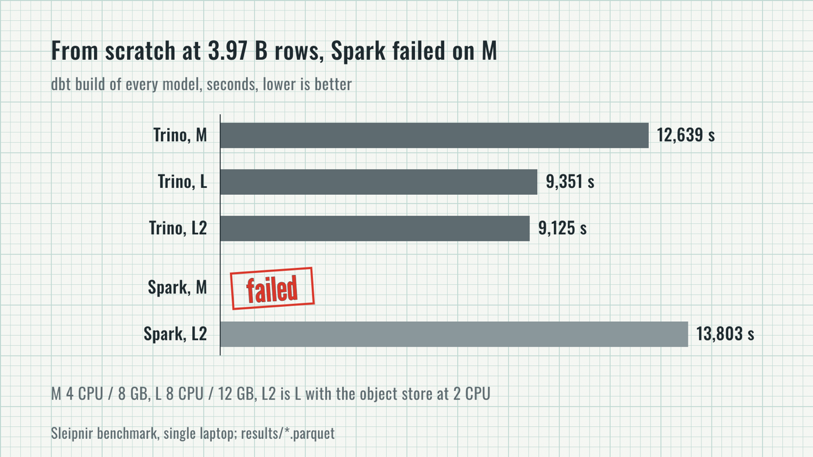

*Build from scratch at 3.97 B rows: Trino on M, L and L2; Spark failed on M and finished on L2.*

The full numbers, including Postgres and the failed runs:

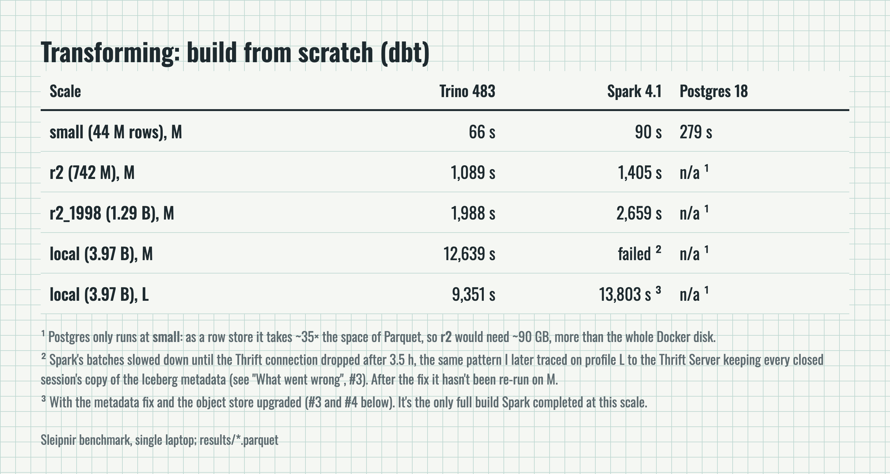

*Full results: build-from-scratch time per engine and scale, including Postgres and the failed runs.*

| Scale | Trino 483 | Spark 4.1 | Postgres 18 |
|---|---|---|---|
| `small` (44 M rows), M | 66 s | 90 s | 279 s |
| `r2` (742 M), M | 1,089 s | 1,405 s | n/a ¹ |
| `r2_1998` (1.29 B), M | 1,988 s | 2,659 s | n/a ¹ |
| `local` (3.97 B), M | 12,639 s | failed ² | n/a ¹ |
| `local` (3.97 B), L | 9,351 s | 13,803 s ³ | n/a ¹ |

¹ Postgres only runs at `small`: as a row store it takes ~35× the space of Parquet, so `r2` would need ~90 GB, more than the whole Docker disk.
² Spark's batches slowed down until the Thrift connection dropped after 3.5 h, the same pattern I later traced on profile L to the Thrift Server keeping every closed session's copy of the Iceberg metadata (see "What went wrong", #3). After the fix it hasn't been re-run on M.
³ With the metadata fix and the object store upgraded (#3 and #4 below). It's the only full build Spark completed at this scale.

### Transforming: reprocess the latest batch

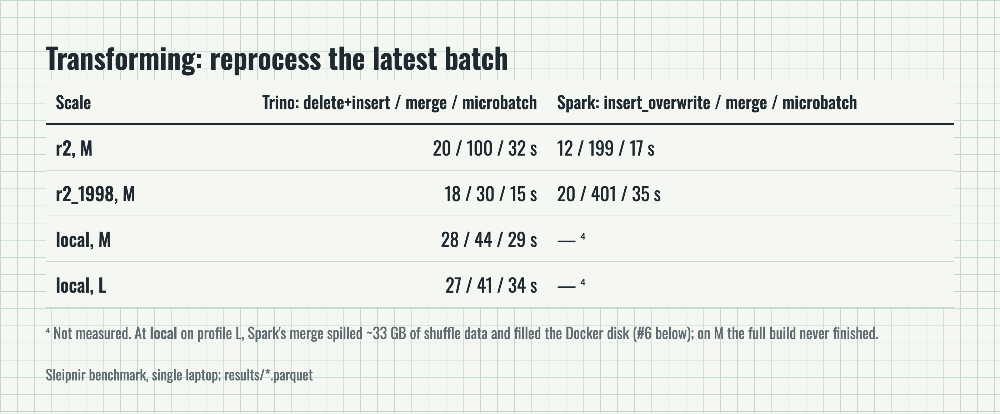

*Reprocessing the latest batch: time per incremental strategy, Trino and Spark.*

| Scale | Trino: delete+insert / merge / microbatch | Spark: insert_overwrite / merge / microbatch |
|---|---|---|
| `r2`, M | 20 / 100 / 32 s | 12 / 199 / 17 s |
| `r2_1998`, M | 18 / 30 / 15 s | 20 / 401 / 35 s |
| `local`, M | 28 / 44 / 29 s | — ⁴ |
| `local`, L | 27 / 41 / 34 s | — ⁴ |

Reprocessing only touches one window, so it barely grows with the table. Spark's merge is the exception: it reads the whole silver table to match keys, so it doubled from `r2` to `r2_1998`.
⁴ Not measured. At `local` on profile L, Spark's merge spilled ~33 GB of shuffle data and filled the Docker disk (#6 below); on M the full build never finished.

### Reading: the questions

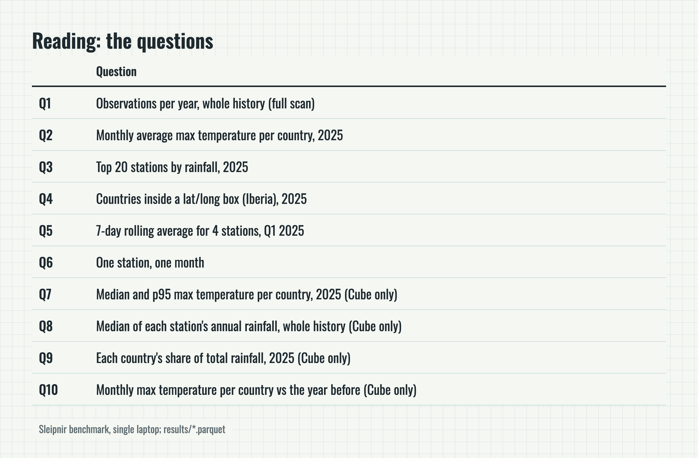

*The ten benchmark questions, Q1 to Q10.*

| | Question |
|---|---|
| Q1 | Observations per year, whole history (full scan) |
| Q2 | Monthly average max temperature per country, 2025 |
| Q3 | Top 20 stations by rainfall, 2025 |
| Q4 | Countries inside a lat/long box (Iberia), 2025 |
| Q5 | 7-day rolling average for 4 stations, Q1 2025 |
| Q6 | One station, one month |
| Q7 | Median and p95 max temperature per country, 2025 (Cube only) |
| Q8 | Median of each station's annual rainfall, whole history (Cube only) |
| Q9 | Each country's share of total rainfall, 2025 (Cube only) |
| Q10 | Monthly max temperature per country vs the year before (Cube only) |

Spark doesn't appear in the read tables: in this benchmark it only writes. The readers are the engines that are built to serve queries; Spark's Thrift Server as a query engine would be a different test.

### Reading: direct SQL (warm, ms)

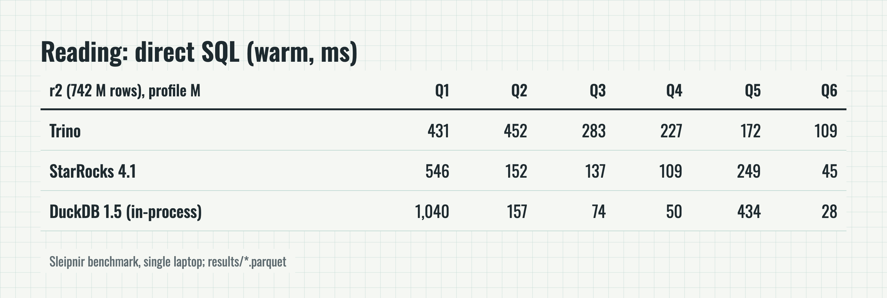

*Direct SQL, warm median in ms, at the r2 scale on profile M.*

| `r2` (742 M rows), profile M | Q1 | Q2 | Q3 | Q4 | Q5 | Q6 |
|---|---|---|---|---|---|---|
| Trino | 431 | 452 | 283 | 227 | 172 | 109 |
| StarRocks 4.1 | 546 | 152 | 137 | 109 | 249 | 45 |
| DuckDB 1.5 (in-process) | 1,040 | 157 | 74 | 50 | 434 | 28 |

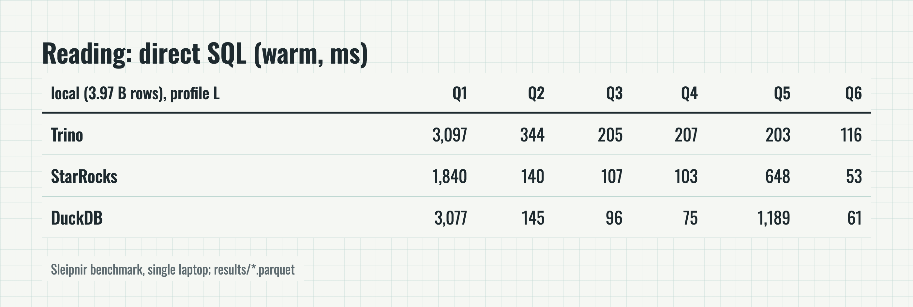

*Direct SQL, warm median in ms, at the local scale on profile L.*

| `local` (3.97 B rows), profile L | Q1 | Q2 | Q3 | Q4 | Q5 | Q6 |
|---|---|---|---|---|---|---|
| Trino | 3,097 | 344 | 205 | 207 | 203 | 116 |
| StarRocks | 1,840 | 140 | 107 | 103 | 648 | 53 |
| DuckDB | 3,077 | 145 | 96 | 75 | 1,189 | 61 |

Only Q1 (and the rolling window in Q5) grows with the data. The filtered questions barely notice the table growing 5×: partition pruning plus a sort order.

### Reading: through Cube (warm, ms)

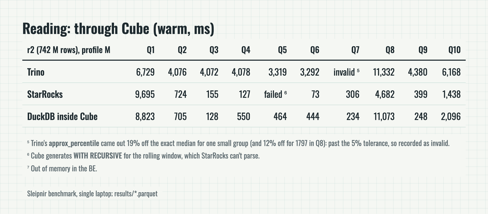

*Through Cube, warm median in ms, at the r2 scale on profile M.*

| `r2` (742 M rows), profile M | Q1 | Q2 | Q3 | Q4 | Q5 | Q6 | Q7 | Q8 | Q9 | Q10 |
|---|---|---|---|---|---|---|---|---|---|---|
| Trino | 6,729 | 4,076 | 4,072 | 4,078 | 3,319 | 3,292 | invalid ⁵ | 11,332 | 4,380 | 6,168 |
| StarRocks | 9,695 | 724 | 155 | 127 | failed ⁶ | 73 | 306 | 4,682 | 399 | 1,438 |
| DuckDB inside Cube | 8,823 | 705 | 128 | 550 | 464 | 444 | 234 | 11,073 | 248 | 2,096 |

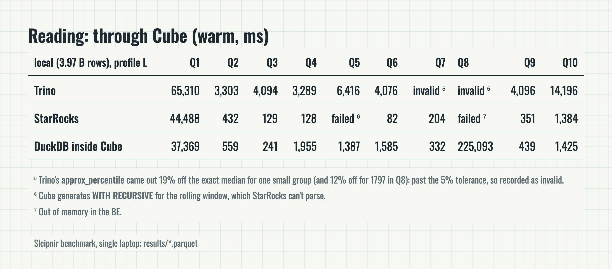

*Through Cube, warm median in ms, at the local scale on profile L.*

| `local` (3.97 B rows), profile L | Q1 | Q2 | Q3 | Q4 | Q5 | Q6 | Q7 | Q8 | Q9 | Q10 |
|---|---|---|---|---|---|---|---|---|---|---|
| Trino | 65,310 | 3,303 | 4,094 | 3,289 | 6,416 | 4,076 | invalid ⁵ | invalid ⁵ | 4,096 | 14,196 |
| StarRocks | 44,488 | 432 | 129 | 128 | failed ⁶ | 82 | 204 | failed ⁷ | 351 | 1,384 |
| DuckDB inside Cube | 37,369 | 559 | 241 | 1,955 | 1,387 | 1,585 | 332 | 225,093 | 439 | 1,425 |

Through Cube, Trino pays a floor of ~3–4 s per question on this setup, which hides most differences on small questions.
⁵ Trino's `approx_percentile` came out 19% off the exact median for one small group (and 12% off for 1797 in Q8): past the 5% tolerance, so recorded as invalid.
⁶ Cube generates `WITH RECURSIVE` for the rolling window, which StarRocks can't parse.
⁷ Out of memory in the BE.

### TPC-H SF8, 22 queries (`r2` scale, profile M)

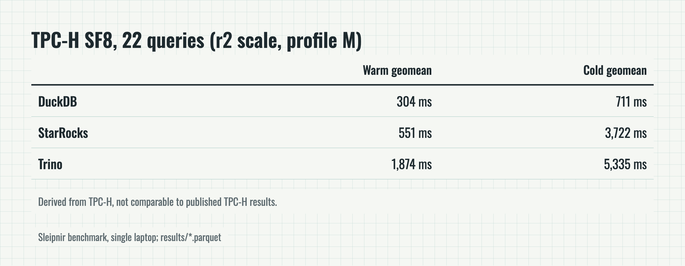

*TPC-H SF8: warm and cold geometric mean over the 22 queries, per engine.*

| | Warm geomean | Cold geomean |
|---|---|---|
| DuckDB | 304 ms | 711 ms |
| StarRocks | 551 ms | 3,722 ms |
| Trino | 1,874 ms | 5,335 ms |

Derived from TPC-H, not comparable to published TPC-H results.

### One year of data, with Postgres (`small`, 44 M rows, profile M)

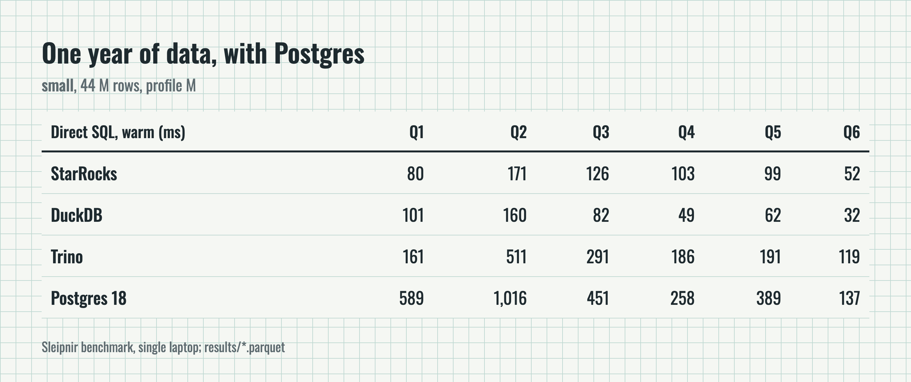

*Direct SQL at the small scale, warm median in ms, with Postgres added.*

| Direct SQL, warm (ms) | Q1 | Q2 | Q3 | Q4 | Q5 | Q6 |
|---|---|---|---|---|---|---|
| StarRocks | 80 | 171 | 126 | 103 | 99 | 52 |
| DuckDB | 101 | 160 | 82 | 49 | 62 | 32 |
| Trino | 161 | 511 | 291 | 186 | 191 | 119 |
| Postgres 18 | 589 | 1,016 | 451 | 258 | 389 | 137 |

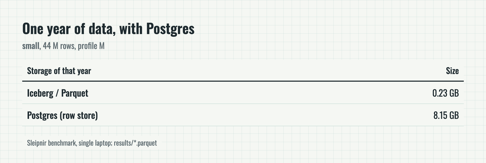

*Storage of that year: Iceberg/Parquet against the Postgres row store.*

| Storage of that year | Size |
|---|---|
| Iceberg / Parquet | 0.23 GB |
| Postgres (row store) | 8.15 GB |

### Acceleration (`r2`, profile M, warm ms; in parentheses the same question without it)

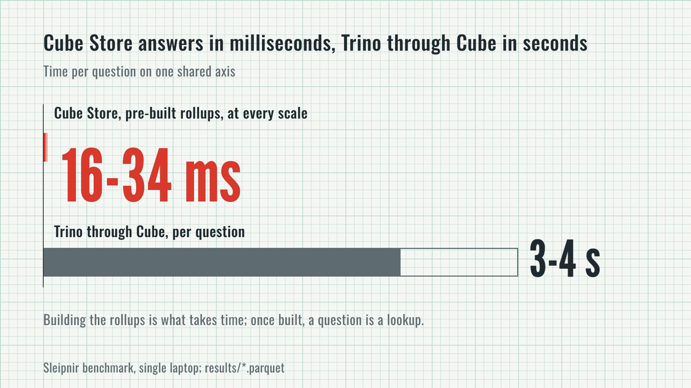

*Cube Store answers in 16-34 ms; Trino through Cube takes 3-4 s.*

The per-question times and the build times:

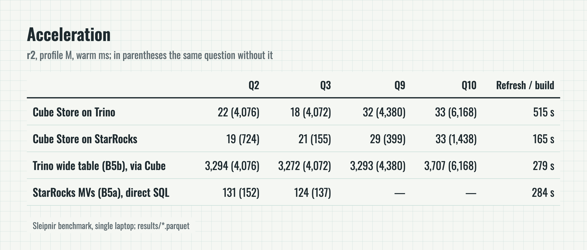

*Acceleration options, warm ms, with the same question without it in parentheses and the refresh or build time.*

| | Q2 | Q3 | Q9 | Q10 | Refresh / build |
|---|---|---|---|---|---|
| Cube Store on Trino | 22 (4,076) | 18 (4,072) | 32 (4,380) | 33 (6,168) | 515 s |
| Cube Store on StarRocks | 19 (724) | 21 (155) | 29 (399) | 33 (1,438) | 165 s |
| Trino wide table (B5b), via Cube | 3,294 (4,076) | 3,272 (4,072) | 3,293 (4,380) | 3,707 (6,168) | 279 s |
| StarRocks MVs (B5a), direct SQL | 131 (152) | 124 (137) | — | — | 284 s |

At `local`, the StarRocks MV refreshed in 909 s on M and ~600 s on L, and the Cube Store rollups built in 846 s on Trino.

- **Cube Store** answered in **16–34 ms** at every scale, whichever engine built the rollups. What takes time is building them: from 165 s (StarRocks, 742 M rows) to 846 s (Trino, 3.97 B rows).
- A note on those build times: the rollups were already **partitioned by year** (28 yearly partitions each, 1998–2025), but every measured build rebuilt **all** of them at once, from a refresh worker with half a CPU and no tuning for parallel builds. That's the worst case on purpose, the cost of building from zero, but it isn't how you'd run it day to day. With an incremental refresh only the partitions whose data changed get rebuilt (usually the latest year), and independent partitions can be built in parallel. The next round measures that too: pre-aggregations refreshed per time partition, instead of everything in one go. Cube makes this possible with a custom SQL in the `refresh_key` that is evaluated **per partition**: with `FILTER_PARAMS` on the partition's time dimension, each year gets its own "signature" of the data (for example `MAX(_batch_id)` plus `COUNT(*)` for that year, or the partition stats from Iceberg's metadata tables, which don't scan any data). If a year's signature didn't change, that partition isn't rebuilt. I've used this pattern before on a smaller model, and it should cut the daily rebuild here to the one year that actually received data.
- **StarRocks materialized views** (one plain copy per gold table) did not beat StarRocks reading Iceberg directly (at `local`, Q1: 2.5 s with the MV, 1.8 s without). A copy saves no work. An MV pays off when it pre-joins or pre-aggregates something, which is a different test.

### Table layout and maintenance (B6, Trino, `r2`, profile M)

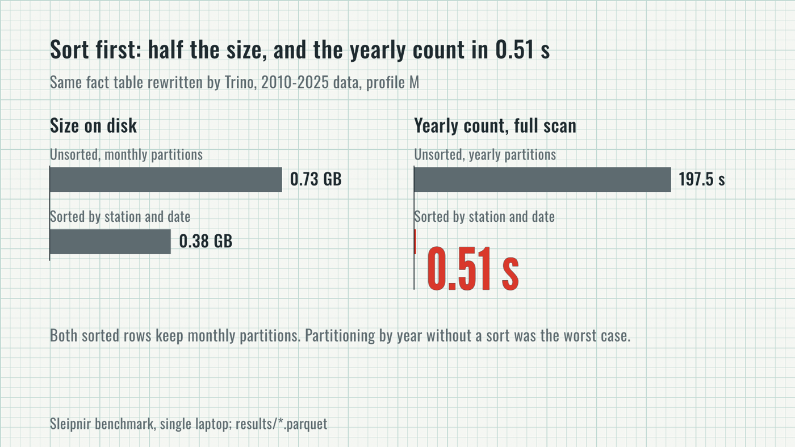

*Sort first: half the size, and the yearly count in 0.51 s instead of 197.5 s.*

Every layout variant I tried, as a table:

Each variant is a full copy of the 190 M-row fact table, written by Trino (z-order by Spark), read with the same direct-SQL questions (warm, ms):

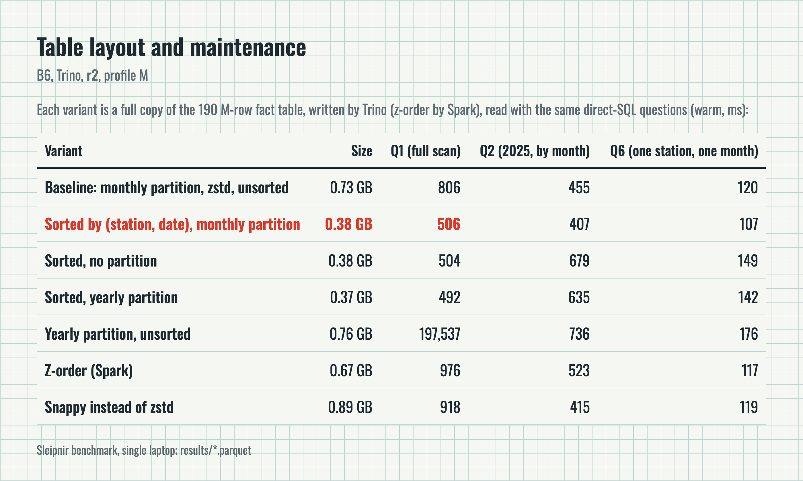

*Table layout variants: size and warm read times for Q1, Q2 and Q6.*

| Variant | Size | Q1 (full scan) | Q2 (2025, by month) | Q6 (one station, one month) |
|---|---|---|---|---|
| Baseline: monthly partition, zstd, unsorted | 0.73 GB | 806 | 455 | 120 |
| **Sorted by (station, date), monthly partition** | **0.38 GB** | **506** | 407 | 107 |
| Sorted, no partition | 0.38 GB | 504 | 679 | 149 |
| Sorted, yearly partition | 0.37 GB | 492 | 635 | 142 |
| Yearly partition, unsorted | 0.76 GB | 197,537 | 736 | 176 |
| Z-order (Spark) | 0.67 GB | 976 | 523 | 117 |
| Snappy instead of zstd | 0.89 GB | 918 | 415 | 119 |

- **Sorting is what paid the most**: half the storage (sorted Parquet compresses much better) and a faster full scan, with no read getting worse.
- **Partitioning by year didn't pay off.** Without a sort order it was the worst case by far (197 s for the yearly count, against 0.5 s sorted). Even sorted, dropping the monthly partition or using yearly ones made the period-filtered questions 60–80% slower: Trino still skips whole months from the metadata, even when each month is only 2–4 MB.
- Z-order lost to a plain sort for these questions.
- The rule I ended with: **sort first; partition by time when queries filter by time; never partition without sorting.**

**Compression and file size.** Same table, same monthly partition, unsorted, only one knob changed at a time:

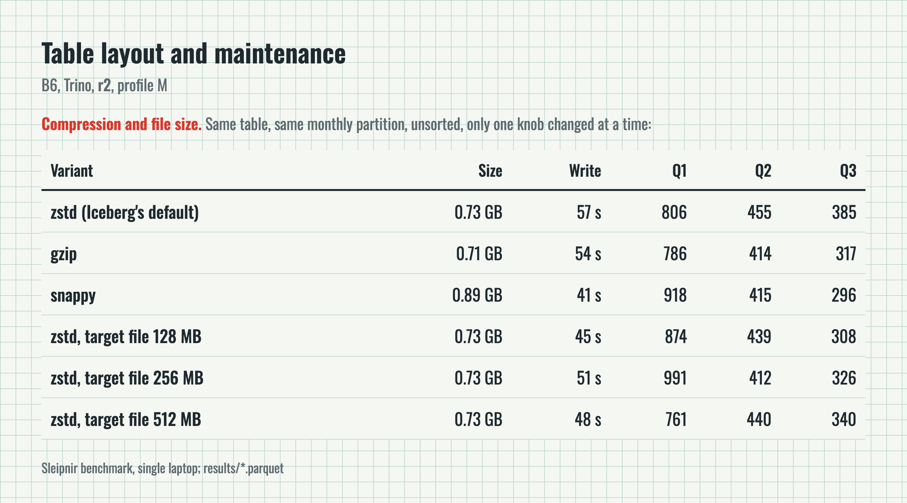

*Compression and target file size: size, write time and read times.*

| Variant | Size | Write | Q1 | Q2 | Q3 |
|---|---|---|---|---|---|
| zstd (Iceberg's default) | 0.73 GB | 57 s | 806 | 455 | 385 |
| gzip | 0.71 GB | 54 s | 786 | 414 | 317 |
| snappy | 0.89 GB | 41 s | 918 | 415 | 296 |
| zstd, target file 128 MB | 0.73 GB | 45 s | 874 | 439 | 308 |
| zstd, target file 256 MB | 0.73 GB | 51 s | 991 | 412 | 326 |
| zstd, target file 512 MB | 0.73 GB | 48 s | 761 | 440 | 340 |

- **Compression:** zstd and gzip came out practically tied (gzip 3% smaller, reads within run-to-run noise). Snappy wrote faster but took 22% more space with no read gain. I kept **zstd** because it's the default for Iceberg tables (Iceberg 1.4+ and Trino) and the usual choice: no reason here to move away from it.
- **File size:** the target size didn't matter at all, and for a simple reason: at 742 M rows a monthly partition holds only 2–4 MB, so every partition is a single file whatever the target. I kept Iceberg's default (512 MB). The usual "files of a few hundred MB" advice matters when partitions are large; with small monthly partitions, sorting is what moved the numbers.
- **For this test**, the winner was: **zstd + Iceberg's default target size + sorted by (station, date) + monthly partition**. With bigger partitions (another dataset, or yearly partitions on much more data) the file size knob would be worth testing again.
- These layouts were only read through Trino. Whether StarRocks and DuckDB react the same way is a fair next test.

Table maintenance (compaction, manifests, expiring snapshots, orphan files) ran as its own measured step on the writers:

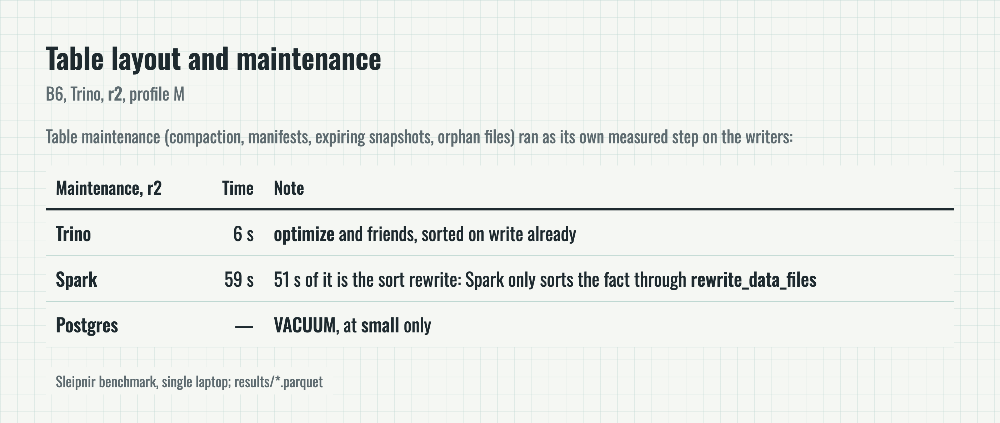

*Table maintenance time per engine.*

| Maintenance, `r2` | Time | Note |
|---|---|---|
| Trino | 6 s | `optimize` and friends, sorted on write already |
| Spark | 59 s | 51 s of it is the sort rewrite: Spark only sorts the fact through `rewrite_data_files` |
| Postgres | — | `VACUUM`, at `small` only |

## The M → L surprise

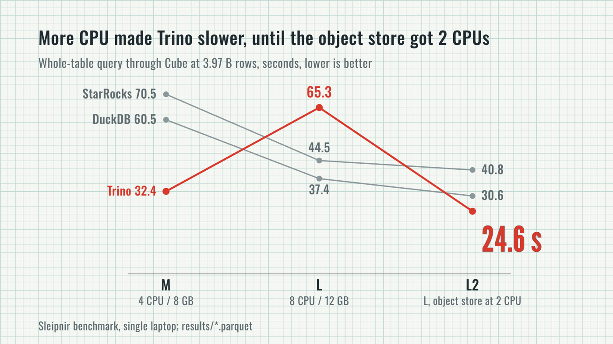

*More CPU made Trino slower, until the object store got 2 CPUs.*

The same numbers as a table:

I expected profile L (twice the CPU) to be faster everywhere. For DuckDB and StarRocks it mostly was. For Trino, the whole-table query through Cube got **2× slower**: 32 s → 65 s.

Q1 (whole-table yearly count) at 3.97 B rows, warm:

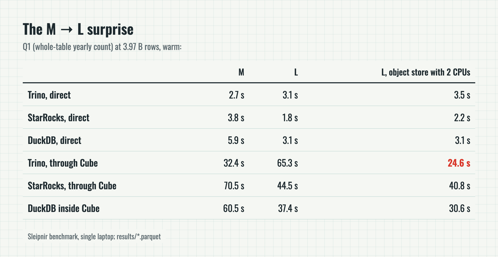

*Q1 at 3.97 B rows by profile: M, L, and L with the object store at 2 CPUs.*

| | M | L | L, object store with 2 CPUs |
|---|---|---|---|
| Trino, direct | 2.7 s | 3.1 s | 3.5 s |
| StarRocks, direct | 3.8 s | 1.8 s | 2.2 s |
| DuckDB, direct | 5.9 s | 3.1 s | 3.1 s |
| Trino, through Cube | 32.4 s | 65.3 s | **24.6 s** |
| StarRocks, through Cube | 70.5 s | 44.5 s | 40.8 s |
| DuckDB inside Cube | 60.5 s | 37.4 s | 30.6 s |

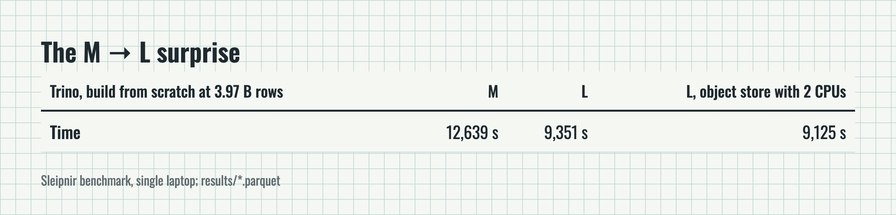

*Trino build from scratch at 3.97 B rows by profile.*

| Trino, build from scratch at 3.97 B rows | M | L | L, object store with 2 CPUs |
|---|---|---|---|
| Time | 12,639 s | 9,351 s | 9,125 s |

The filtered queries didn't move, and the object store sat at 1 CPU in every profile (shared infrastructure held constant, as the rules say). An engine with 8 CPUs was just sending more requests to an object store that couldn't keep up.

So I ran profile L again with the object store at 2 CPUs. Same Trino query: **24.6 s**. Faster than M, finally.

Where this matters: if you benchmark (or size) an engine against a self-hosted object store, the object store can be the thing you're measuring. Where it doesn't: managed object storage scales on its own, so in the cloud this specific bottleneck should mostly go away. That is one of the things the next round will check.

Looking back, I could have explored the object store's limits on purpose instead of just bumping into them. My local S3 sat on the same machine, with almost no latency per request and only a CPU and memory cap. Real S3 behaves differently: AWS documents around 3,500 writes and 5,500 reads per second per prefix, and every request pays tens of milliseconds, which adds up fast when a table is thousands of small Parquet files. Throttling the local object store to something closer to that (latency, request rate) would have made the local numbers a better preview of the cloud ones. That goes on the list too.

## How long it took

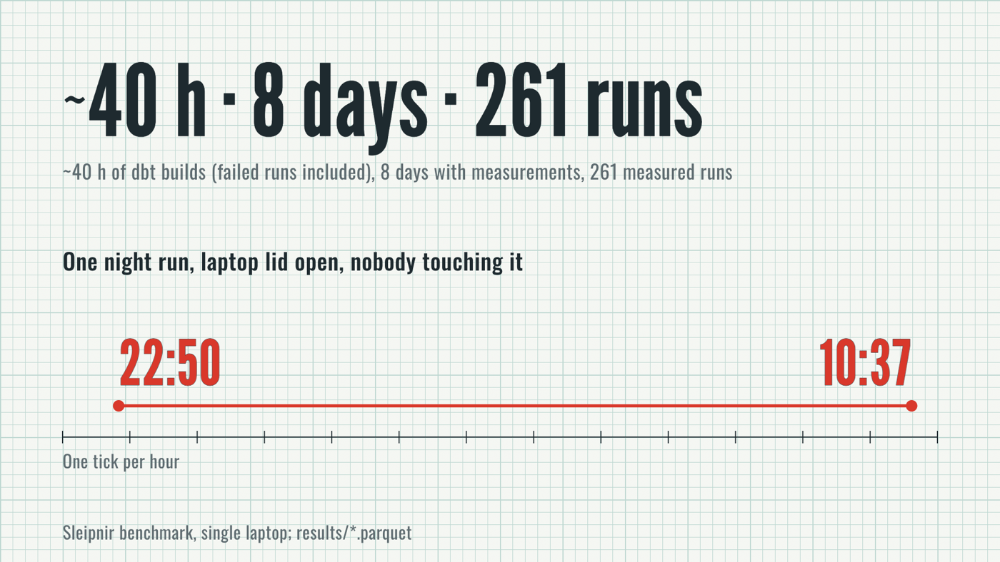

*About 40 h of dbt runs, 8 days, 261 runs, and one night run from 22:50 to 10:37.*

The same numbers as a table:

About three weeks from the first commit to the last measurement. The spec and the first working lakehouse took two days (October 9–10), with the AI assistant doing most of the scaffolding. The benchmark itself ran from **October 11 to October 28**:

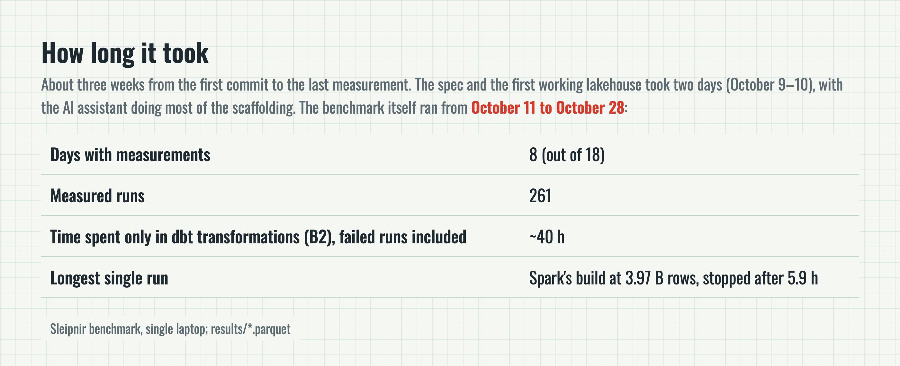

*How long it took: days, runs and hours of measurements.*

| | |
|---|---|
| Days with measurements | 8 (out of 18) |
| Measured runs | 261 |
| Time spent only in dbt transformations (B2), failed runs included | ~40 h |
| Longest single run | Spark's build at 3.97 B rows, stopped after 5.9 h |

A lot of that ran **overnight**. The long builds (Trino and Spark at 3.97 B rows take 2.5 to 4 hours each) only made sense with the Mac left alone, lid open, plugged in, kept awake: one night Spark ran from 22:50 until it was stopped in the morning, another the whole second profile-L campaign ran from 22:50 to 10:40. The days in between went mostly into reading logs and heap dumps to understand why something failed... which is where the next section comes from.

All those writes, spills and swaps came with a small bill too: the benchmark took almost **1% of my MacBook's SSD health** xD

## What went wrong (the fun part)

Most of the time on this project went here. Each of these looked like an engine problem at first.

**1. The laptop fell asleep.** Trino threw `ABANDONED_TASK` in the middle of a run, twice. The clue was query IDs lagging behind the log clock. macOS went into idle sleep and froze the Docker VM, once mid-run and once in a gap *between* runs, where the per-command `caffeinate` didn't cover. Now the whole campaign runs under one keep-awake, and a run only starts when the machine is idle.

**2. Swap.** Profile L needs a 20 GB Docker VM on a 24 GB Mac. On the first night with that VM I was also using the Mac, macOS ended up with 15.7 of 16 GB of swap in use, and the build came out 17% slower than the same build on profile L a few days earlier. Those runs are invalidated, and the campaign script now logs free memory and swap before and after each measured step. If you run something like this on a laptop: run it at night, with nothing else open xD

**3. Spark's heap kept growing.** On the long build, each batch got slower: 10 s, then 30, then 190. The object store was idle, Spark was at 770% CPU and 11 of 12 GB, mostly doing garbage collection. A heap histogram showed **4.4 million Iceberg snapshot objects**. The Spark Thrift Server keeps every closed JDBC session alive, dbt opens one per batch, and each kept session held its own catalog with a cached copy of the table metadata (with the full snapshot list). Memory grew with commits × sessions. Turning off two catalog caches fixed it, and the same pattern had slowed down and killed the earlier run on profile M.

**4. Then the object store ran out of memory.** With Spark fixed, RustFS got OOM-killed after a couple of hours of writes, at 3 GB and then at 5 GB. Its background scanner holds metadata for every object it walks, and Iceberg writes a lot of small files. A newer release fixes part of it; with the scanner off, the object store stayed under 3 GB for the whole build.

**5. StarRocks' MV refresh blew up.** Out of memory on M and on L. The DDL had 16 buckets, sized for the 742 M scale. In StarRocks buckets count *per partition*, and the table has 3,156 monthly partitions at the full scale: ~50,000 tablets, each with its own write buffer. With 2 buckets per partition it refreshed on both profiles.

**6. The disk filled up.** Spark's `MERGE` on the 3.97 B-row silver table spilled ~33 GB of shuffle data and filled the Docker disk. That is where this round stopped.

**7. My own bugs.** A result table showed the *median* of the two build passes instead of their sum (6,320 s instead of 12,639 s). A pre-aggregation build check counted rollups that another engine had left behind and declared victory after 10 seconds. Both were caught because the numbers looked too good... which is a pretty good rule of thumb.

### Smaller gotchas worth knowing

None of these broke a run for long, but each one cost me an evening:

- **Trino's dedup couldn't spill.** `ROW_NUMBER() ... = 1` ran out of memory even with spill-to-disk on: Trino rewrites it into a TopNRanking operator, and that operator doesn't spill. `optimizer.optimize-top-n-ranking=false` fixed it (and it's recorded with the results, like every non-default setting).
- **dbt runs a model's post-hook after every microbatch.** With table maintenance as a post-hook, a 192-month backfill would have compacted and expired snapshots 192 times. Maintenance now runs once per table, as its own measured step.
- **Iceberg has no `CLUSTER BY`.** You get a table sort order instead, and each engine spells it differently: Trino's `sorted_by`, Spark's `WRITE ORDERED BY` (only on an existing table) or `rewrite_data_files`. And Spark's rewrite silently skips a partition that has a single file, so z-ordering needs `rewrite-all`.
- **Spark won't remove orphan files younger than 24 h**, so its maintenance can't be identical to Trino's (which cleans immediately). The difference is written down next to the numbers.
- **A StarRocks MV has to match the query's shape, not its intent.** A wide MV with all the joins served none of the SQL that Cube generates, because Cube only joins the tables a question uses. A boring copy of each table, with no joins, matched everything.
- **Cube sends DECIMAL columns to Cube Store as `Decimal(18,5)`.** Sums lose everything past 5 decimals and tiny values become 0. Casting every measure that feeds a pre-aggregation to `DOUBLE` avoids it (a lesson from earlier Cube work that went straight into the rules).
- **The newest isn't always usable.** dbt Core v2 had no Trino or Postgres adapter yet, and Iceberg v3 tables weren't fully supported by Trino and StarRocks, so the whole project stayed on dbt Core 1.x and Iceberg v2.

## Things that surprised me

- **Sorting beat partitioning, but partitions still earned their keep.** Sorting the fact table halved the storage and made the yearly count 37% faster. Dropping the monthly partitions made period filters 60–80% slower, even with partitions of 2–4 MB (see the layout table above).
- **Approximate functions fail correctness checks.** Trino's `approx_percentile` was 19% off the exact median for one small group. Fine for a chart; not fine if you compare engines on "the same answer".
- **A row store pays for it in disk.** The 2025 data takes 0.23 GB as Iceberg/Parquet and 8.15 GB inside Postgres, about 35× more. That's why Postgres only runs at the smallest scale.

## Back to my three questions

**How far does Postgres go?** Further than people usually assume, for queries. With one year of data (44 M rows) the same dbt project built from scratch in 279 s on Postgres against 66 s on Trino, and Postgres answered the weather questions in 137 ms–1 s, against 32–511 ms for the columnar engines. That's slower, but fine for a lot of real use. What stopped it was **storage**: that year takes 8.15 GB in Postgres and 0.23 GB as Parquet, so 742 M rows would need ~90 GB, more than the whole Docker disk. If your data is in the tens of millions of rows, Postgres is probably enough. In the hundreds of millions and up, the disk makes the decision before the queries do.

One thing I didn't test, and should have: Postgres with **columnar storage**. Extensions like TigerData's columnstore (TimescaleDB), `pg_duckdb` or Citus columnar go straight at the storage problem, and could move the line where Postgres stops being enough. That goes into the next round.

**Do the new versions of Spark and Trino change the picture?** I can only half answer this one, because I didn't run the old versions side by side (that's a fair next test). What I can say: Spark 4.1 with Iceberg 1.12 ran the same dbt project as Trino 483 with no model changes, and at 3.97 B rows it needed two fixes that had nothing to do with its query engine (a session leak and the object store). Trino 483 was the steadiest writer of the whole project: when it failed, it was its per-query memory limit on a write that was too big at once (a yearly batch of ~28 M rows, a single `CREATE TABLE AS` of 1.1 B rows), and writing in smaller batches fixed it every time.

**Is DuckDB good for ingestion and compression?** Yes, for this shape of data. It loaded 742 M rows in 146 s (5 M rows/s) and wrote the bronze layer at 1.98 GB from 3.36 GB of gzipped CSV. As a reader it surprised me too: the fastest on three of the five filtered questions and on TPC-H at SF8, while running inside the benchmark process. Where it wouldn't fit: many concurrent users, or several services reading the same tables, which is exactly where a server engine earns its place.

All of this is DuckDB 1.5. DuckDB 2.0 came out on October 21, with these runs already going, so it isn't here: not for compatibility reasons, it just didn't exist yet when I pinned the versions. It brings async I/O for Parquet and a client-server mode, which touches both answers above, so it gets its own side-by-side run.

## What these numbers can and can't tell you

They can tell you how these engines behave relative to each other, on one node, with the same limits, on an append-heavy time series, and which tricks moved which questions.

They also carry the noise of a laptop: swap, background processes, an object store with none of S3's latency or request limits. I removed what I could see; the cloud run is where I expect a fairer comparison.

They can't tell you how the engines behave on a cluster, on a different data shape (heavy updates, wide joins, high concurrency), or with each engine tuned by someone who knows it well. Some results here (the object store bottleneck, the Spark session leak, the disk filling up) are about this setup as much as about the engines.

## What's next

The next step is to run the same benchmark in the cloud, with managed object storage and more workers, to see whether the results change when the laptop is out of the picture: does Trino scale differently with more workers, does Spark's merge still need that much local disk, does the object store stop being the bottleneck? I'm testing that now, and when I have results I'll write a new post.

Before or along with it: DuckDB 1.5 against 2.0 on the same data, which is the closest I'll get to answering "do new versions change the picture?" for at least one engine, and Postgres with a columnar extension, to see how far that pushes the "how far does Postgres go" line. And Cube's pre-aggregations refreshed per year partition (only what changed, in parallel) instead of rebuilt in one go.

After that comes orchestration (Airflow) on top of the same stack.

The code, the spec, every result file and the list of invalidated runs are in the repo: [github.com/jhorlima/sleipnir](https://github.com/jhorlima/sleipnir)

If you've run something similar and got different numbers, I'd really like to hear about it :D
